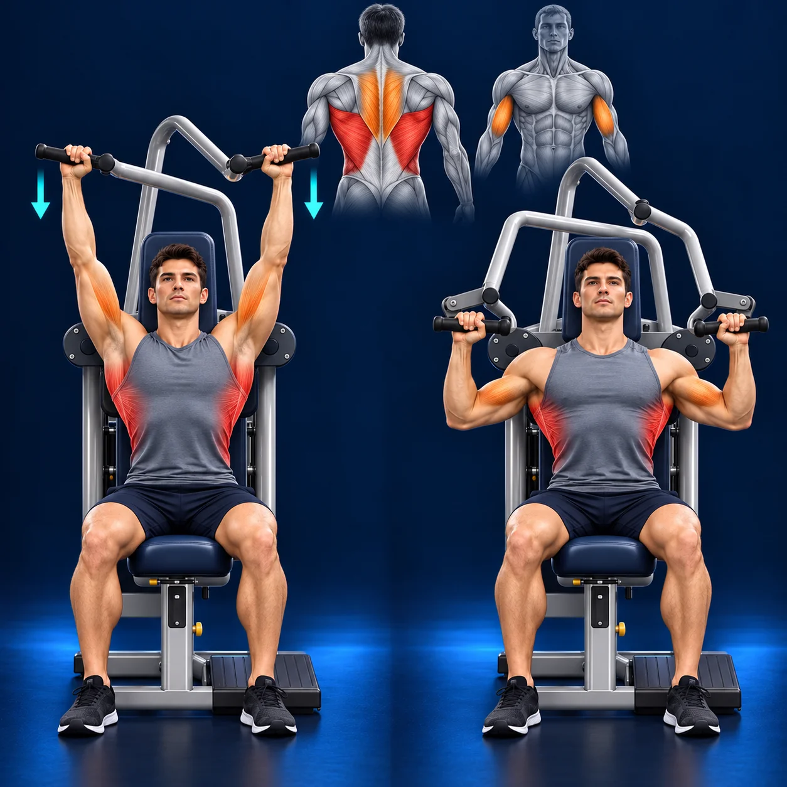

# Exercise image reference

Approved by Jarda on 15 October 2026 for future Gym Tracker exercise images.

## Canonical reference

Reference asset: `exercise-guides/v194/technogym-vertical-traction.webp`.
This is the approved v194 muscle-highlighted image, NOT the earlier v193 image without muscle highlights. Preserve this reference when adding newer artwork.

## Match these characteristics

- Dark navy background with subtle blue floor/rim lighting.
- Realistic, clean fitness illustration of the correct machine and exercise.
- Two clearly separated phases: start and finish, with consistent person and equipment.
- Correct posture, grip, lever geometry and movement; use supplied machine photos when available.
- Main working muscles highlighted red; assisting muscles highlighted orange.
- Add a clear compact front/back anatomical inset when the primary muscles are otherwise hidden.
- Do not highlight unrelated muscles. Choose anatomical regions for each exercise, not by copying this exercise's muscle map.
- Turquoise movement arrows where useful; no extra text, logos or watermarks.
- Square composition that stays legible on iPhone cards and in expanded detail.
- Keep the whole movement readable, without cropped hands, handles or feet.
- Optimize the final app asset as WebP and update offline caching when publishing it.

## Reusable generation brief

Use the canonical reference as a STYLE reference, not as the exercise subject. Create the requested exercise on its actual equipment. Match the navy/blue lighting, realistic illustration, two-phase layout and anatomy-overlay style. Highlight the correct primary muscles red and secondary muscles orange. Include a compact anatomical inset if the working muscles are obscured. Preserve accurate movement and equipment geometry. No text, logos or watermark. Verify anatomy and both phases before publishing.

The user explicitly approved this as the default for subsequent exercise images. Existing unrelated images should not be replaced unless requested.
